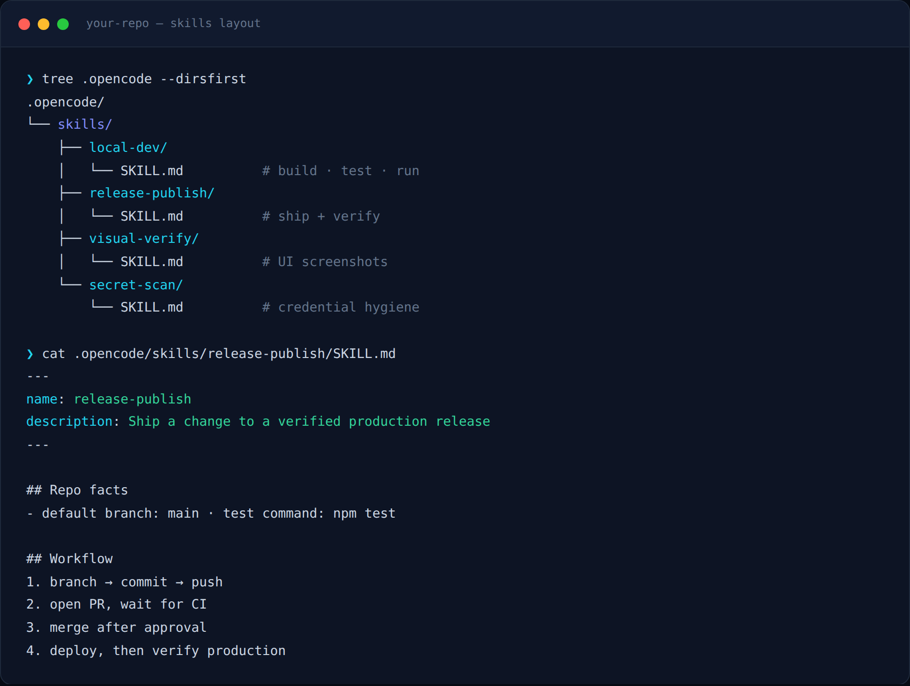
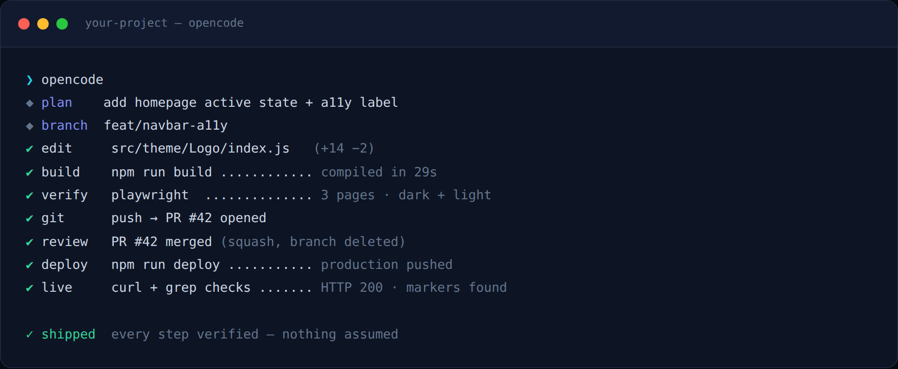
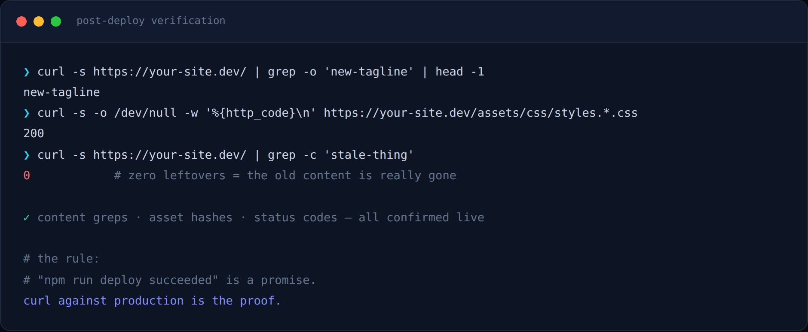

**OpenCode** is an open-source AI coding agent that lives in your terminal. It reads your repository, edits files, runs commands, opens pull requests — and works with almost any model provider, so you're never locked into one vendor. But the difference between an AI agent that *demos well* and one you can **trust with real work** comes down to three things: repo-specific context, a verified workflow, and security discipline. This post is a practical guide to all three, and everything here applies to **any project** — a static site, a service, an infrastructure repo.

<!-- truncate -->

## Why skills change everything

An agent starting in an unfamiliar repo knows nothing about your conventions: how you build, how you deploy, which environment variables exist, which commands are traps. Every session starts with you re-explaining context.

**Agent skills** fix that. In OpenCode, a skill is a markdown file that lives *inside your repository*:

```
.opencode/skills/<skill-name>/SKILL.md
```

Think of it as documentation the agent **actually reads** — loaded on demand through the native `skill` tool when its description matches the task at hand. Because skills are committed next to the code:

- **They're versioned** — context evolves with the repo, not in someone's notes app
- **They're reviewable** — a PR that changes deployment steps also updates the skill that describes them
- **They're shareable** — every teammate's agent inherits the same knowledge



## Anatomy of a good skill

Each skill is a folder with a `SKILL.md` that must start with YAML frontmatter — `name` (which must match the folder name, lowercase-with-hyphens) and a specific `description` (the agent chooses skills by reading it, so vague descriptions get ignored):

```markdown
---
name: release-publish
description: Ship a change to a verified production release
---

## Repo facts
- default branch: main · test command: npm test

## Workflow
1. branch → commit → push
2. open PR, wait for CI
3. merge after approval
4. deploy, then verify production
```

Keep each skill **small and sharp**. One skill per repeated workflow — `local-dev`, `release-publish`, `secret-scan` — beats one giant "everything" skill. Two rules of thumb:

1. **Commands verbatim** — exact build/serve/deploy commands, including any required environment variables. Agents copy-paste; give them the right thing to copy.
2. **Gotchas belong in the skill** — the weird crash you already solved once? Write it down. The agent shouldn't rediscover it, and neither should you.

You can also expose a skill as a `/slash` command or restrict its permissions per agent in `opencode.json` — see the [Agent Skills docs](https://opencode.ai/docs/skills/) for the full reference.

## The verified loop

Autonomy without verification is just speed with risk. The workflow that earns trust is a **closed loop** where every step produces checkable evidence:



The pattern, portable to any stack:

- **One branch per change** — the agent works on `feat/...`, never directly on `main`
- **Build is the first gate** — `npm run build` (or your equivalent) must pass *before* anything else
- **Humans review PRs** — you approve the diff; the agent never self-merges
- **Deploy is a separate, repeatable step** — same command every time
- **Live is checked last** — the loop isn't closed until production confirms it

## Verify like you mean it

"The deploy succeeded" is a promise. **Production is the proof.** After any deploy, a few cheap `curl` checks convert hope into evidence:



For visual or interactive work, screenshots beat greps: a tiny Playwright script that loads the changed pages (in dark *and* light mode) catches broken layout, missing styles, and regressions a text check never sees. The habit generalizes: **pick the cheapest check that would actually fail if the change was wrong**, and run it every single time.

## Security discipline

Giving an agent shell access means secrets are one `cat` away from leaking. Non-negotiables:

- **`.env` is gitignored; `.env.example` is committed** — with placeholder values only:

```bash
GITHUB_TOKEN=github_pat_replace_me
GIT_USER=your-github-username
```

- **Tokens never get printed** — not in logs, not in PR descriptions, not in screenshots. Read them from the credential store at runtime.
- **Least privilege** — fine-grained tokens scoped to exactly the repos and permissions the workflow needs.
- **The agent commits code, never credentials.** If a secret ever lands in a branch, rotate it first and clean history second.

## Getting started

You don't need to automate everything on day one. Start with **the one task you've explained to your agent more than twice** — usually local dev setup or your deploy flow. Write it as a skill, run the loop on a real change, and add the gotchas you hit. Within a week your repository will carry a complete, reviewable playbook of how it's built, shipped, and verified — and your agent will finally know it too.

If you'd rather not start from zero, I maintain **[opencode-skills](https://github.com/vinaykagithapu/opencode-skills)** — a small MIT-licensed starter pack of four generic skills (`local-dev`, `release-publish`, `visual-verify`, `secret-scan`) you can copy into any repo and customize.

OpenCode is free and open source — the [docs](https://opencode.ai/docs/) cover agents, skills, MCP servers, and the SDK. If you automate your workflow, automate the verification too. That's the part that lets you sleep at night.
