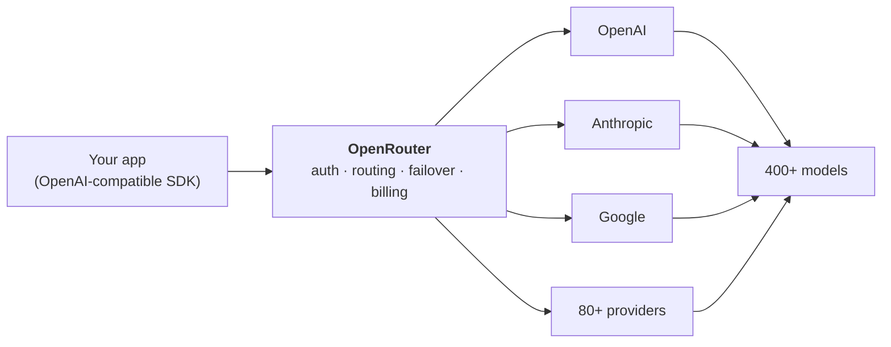
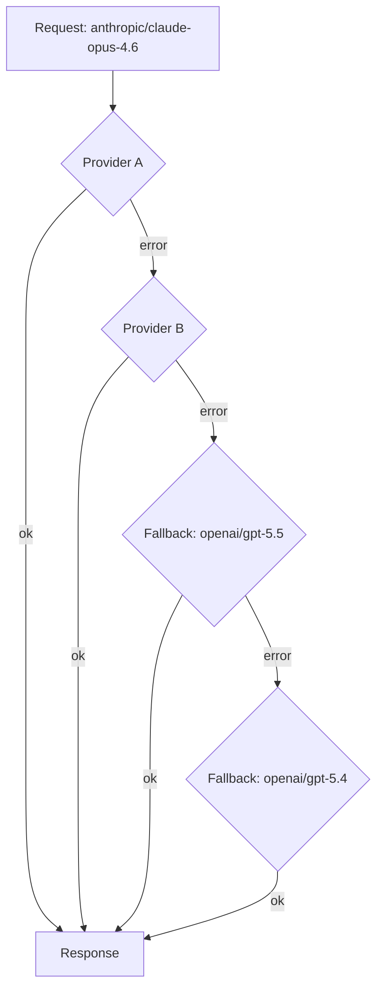

Every AI lab ships its own SDK, its own request shape, its own billing page. Building against two providers means two integrations; evaluating five means five. **OpenRouter** collapses that into one OpenAI-compatible endpoint: `POST https://openrouter.ai/api/v1/chat/completions`, a `model` field like `anthropic/claude-opus-4.6`, and everything else — provider selection, failover, unified billing — handled underneath. It's now a serious piece of AI infrastructure: 400+ models from 80+ providers, 10+ trillion tokens processed per day, and as of August 2026, an acquisition by Stripe that's still working through regulators.

<!-- truncate -->

:::info Why this matters now
On **August 19, 2026**, [Stripe announced it is acquiring OpenRouter](https://stripe.com/newsroom/news/stripe-agrees-to-acquire-openrouter) (~$7.5B per [NYT](https://www.nytimes.com/2026/08/19/business/stripe-openrouter-ai.html)); the deal is **not yet closed** — Australia's ACCC has it under phase-1 assessment with a determination period ending **November 16, 2026**. Nothing changes for users today, but a gateway sits between you and every model provider, so it's worth understanding exactly what it does and what you're committing to.
:::

## What OpenRouter is (and isn't)

OpenRouter is a **managed LLM gateway** — a proxy that normalizes hundreds of models behind one API. Your app talks to OpenRouter; OpenRouter talks to providers, translating request shapes, picking endpoints, and tracking spend.



**It is:**
- One OpenAI-compatible API — existing OpenAI SDK code works by swapping the base URL
- A routing layer — pick providers by price, latency, throughput, region, or data policy
- Unified billing — one balance across every model, with per-model/per-key spend analytics

**It isn't:**
- **Not open source and not self-hostable** — it's a hosted service (if you need to self-host, that's LiteLLM or similar — more below)
- Not an app or a model trainer — it's plumbing between your code and the labs
- Not a markup machine — inference is billed at each provider's *list price*; the platform fee lands on credit purchases, not per-token (details below)

Scale check: when I pulled the public models API for this post, it listed **456 models** — and 16 `:free` variants you can call without a credit card.

## Migration is a base-URL swap

Because the API is OpenAI-compatible, moving an existing integration takes two changes: the base URL and the model slug (`provider/model`):

```python
from openai import OpenAI

client = OpenAI(
    base_url="https://openrouter.ai/api/v1",
    api_key=os.environ["OPENROUTER_API_KEY"],
)

resp = client.chat.completions.create(
    model="openai/gpt-5.5",          # or anthropic/claude-opus-4.6, google/...
    messages=[{"role": "user", "content": "Summarize this RFC in five bullets."}],
)
```

Three integration paths, depending on how much control you want: raw HTTP (any language, zero dependencies), the client SDKs (typed calls), or the **Agent SDK** for tool-use loops and state. Streaming, function calling, and structured outputs pass through as long as the underlying model supports them.

## Two layers of routing

This is where a gateway earns its keep. OpenRouter routes on two independent layers:

### 1. Provider routing — same model, many vendors

One model slug often maps to several providers serving the identical model. By default OpenRouter uses **price-weighted routing** (favoring cheaper endpoints via an inverse-square weighting), deprioritizing any provider that saw outages in the last 30 seconds. You can override per request:

| You want | Set | Effect |
|---|---|---|
| Cheapest option (default) | *(nothing)* or `model:floor` | Price-sorted endpoints first |
| Fastest responses | `model:nitro` | Sorted by throughput instead of price |
| Prefer low latency | `provider: { preferred_max_latency: 2 }` | Prefer endpoints under 2s (p50) |
| Pin one provider (compliance, BYOK, region) | `provider: { order: ["openai"], allow_fallbacks: false }` | Hard stop — no silent fallback |
| Filter by data policy | `provider: { data_policy: { ... } }` | Only endpoints meeting your policy |

The `:nitro` and `:floor` suffixes are *routing variants* — they work on every model and change how endpoints are sorted, not what the model is. Reach for `:nitro` on user-facing chat where latency is felt, `:floor` on batch jobs where cost is the constraint.

### 2. Model fallbacks — when the model itself is unavailable

If every provider for your chosen model fails, OpenRouter can fall through to a chain of alternative **models**:

```json
{
  "model": "anthropic/claude-opus-4.6",
  "models": ["openai/gpt-5.5", "openai/gpt-5.4"],
  "route": "fallback"
}
```



Failed attempts don't burn your budget: under **Zero Completion Insurance**, an attempt that errors isn't charged for its model tokens. There's also `openrouter/auto` — an auto-router that picks a model for you based on your constraints, useful for prototypes before you've decided on a model.

## How pricing actually works

The core rule: **inference is billed at each provider's list price — OpenRouter adds no per-token markup.** The platform fee is charged when you buy credits instead:

| Path | What you pay | Platform fee |
|---|---|---|
| **Standard** (credits) | Provider list price per token | **5.5%** on credit purchases |
| **Business** (credits) | Provider list price per token | **8%** on credit purchases |
| **BYOK** (your provider keys) | Provider bills you directly | Fee-free up to a plan-dependent monthly allowance (the pricing page puts Standard/Business at $25k list-price inference/month), then **5%** of list |
| **Free tier** | $0 | Rate-limited `:free` variants + `openrouter/free` router; buying ≥ $10 credits raises the daily limit |

Live prices I pulled from the public `/api/v1/models` endpoint while writing this (USD per million tokens):

| Model slug | Input | Output | Context |
|---|---|---|---|
| `openai/gpt-4o` | $2.50 | $10.00 | 128K |
| `openai/gpt-5.4` | $2.50 | $15.00 | 1.05M |
| `openai/gpt-5.5` | $5.00 | $30.00 | 1.05M |
| `anthropic/claude-opus-4.6` | $5.00 | $25.00 | 1M |

Cost transparency is unusually good: the models API returns every model's pricing **without an API key**, the Activity page filters spend by model, provider, and API key, and each response's `id` can be queried later for exact token counts and cost. On paid plans you also get budgets and spend controls.

**The honest caveat:** if you qualify for committed-use or volume discounts *direct* with a provider (often 20–40% off), direct can beat the gateway outright. The credit fee buys routing, failover, one invoice, and model flexibility — worth it when you use multiple models or need availability; less so when you're all-in on one provider at scale.

## Data policies, regions, and your keys

Gateway ≠ trust-by-default. Three controls worth knowing:

- **Routing filters** — constrain endpoints by data policy, zero-data-retention (ZDR) status, quantization, price, and region before a request ever leaves
- **In-region routing** — `eu.openrouter.ai` serves EU-eligible models from EU endpoints (Business/Enterprise plans)
- **BYOK** — bring your own provider keys; they're stored encrypted, tried in priority order with fallback keys behind them, and let you keep rate-limit and billing relationships direct with the provider

OpenRouter proxies requests and works with providers to avoid logging prompts/completions or using them for training where possible — but for strict workloads, verify your provider's policy and prefer ZDR-filtered endpoints.

## Extras that make it agent-friendly

- **Hosted MCP server** (`https://mcp.openrouter.ai/mcp`, OAuth) — agents can discover and compare models programmatically
- **[Rankings](https://openrouter.ai/rankings)** — leaderboards by *real* token usage, not vendor benchmarks; useful signal when choosing a model
- **Per-model `llms.txt`** — `openrouter.ai/{author}/{model}/llms.txt` returns one markdown doc with price, context length, and supported APIs. Machine-readable model cards — the same idea as this site's own [`llms.txt`](/llms.txt)
- **Batch variants** (`:batch`) for discounted offline workloads
- **Generation stats API** — query cost and token counts by response `id` for chargeback-grade accounting

## When OpenRouter is the right call

| Situation | Best fit |
|---|---|
| Prototype / multi-model app / want failover | **OpenRouter** |
| Swap models without touching app code | **OpenRouter** |
| Single provider, committed-use discount tier | **Direct API** |
| Must self-host, open-source control plane | **LiteLLM** (or Portkey, Cloudflare AI Gateway…) |
| Enterprise SSO, admin controls, in-region routing | OpenRouter Business/Enterprise |

Both OpenRouter and LiteLLM expose one OpenAI-compatible API across many providers — the difference is *where the routing layer runs*: OpenRouter is managed infrastructure you don't operate; LiteLLM is an open-source proxy you deploy and own. Many teams even run both: managed for production traffic, self-hosted for controlled workloads.

## The Stripe question

The acquisition pairs Stripe's payments rails with OpenRouter's token-routing rails — unsurprising, since OpenRouter's CEO has described the company as "Stripe for AI" since the May 2026 Series B. Deal terms are subject to closing conditions and regulatory review (ACCC determination period ends November 16, 2026).

Practical advice doesn't change: **keep your exit cost low.** Because everything speaks the OpenAI-compatible protocol, your migration cost out is the same as your migration cost in — a base URL and model slugs. Watch BYOK fee terms and credit pricing after close; those are the levers a new owner is most likely to touch.

## Getting started

1. Create a key at [openrouter.ai/keys](https://openrouter.ai/keys) → `OPENROUTER_API_KEY` in your environment
2. Experiment on the **free tier** (`:free` variants, 16 available right now) before buying credits
3. Swap your base URL, pin a model, then loosen the `provider` constraints as you learn what matters (price? latency?)
4. Set a **budget** on day one — spend controls exist precisely because token bills surprise people

Docs live at [openrouter.ai/docs](https://openrouter.ai/docs), the full catalog at [openrouter.ai/models](https://openrouter.ai/models), and pricing at [openrouter.ai/pricing](https://openrouter.ai/pricing). If you're also picking AI *coding* tools to pair with it, my [AI Tools guide](/docs/ai-tools/) covers OpenCode, Cursor, and Claude Code — most of them plug straight into an OpenRouter key.

One endpoint, hundreds of models, and a switch you can flip per request — that's the whole pitch. Route deliberately, budget early, and verify your fallback chain actually fires before you need it.
