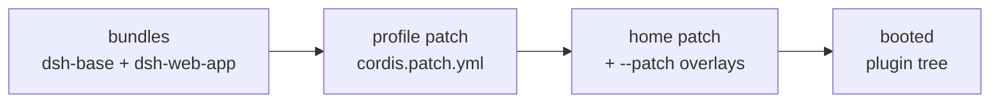

# Core Concepts

Nine words explain most of `dsh`: **profile**, **bundle**, **patch**, **plugin**, **workspace**, **session**, **turn**, **preset**, and **permission**. Learn them once and the rest of the docs read easily.

## Profiles, bundles, and patches

A running `dsh` is a **plugin tree composed at boot** from ordered layers.



| Term | Meaning |
|---|---|
| **Profile** | A named composition stored in the Harness home. `web`, `headless`, `sdk`, `sdk-minimal`, and `acp` ship as templates and auto-initialise on first use |
| **Bundle** | A distributable list of config rows plus the code they mount. `dsh-base` is the shared first layer: model access, tools, persistence, sandbox, approvals, settings, credentials |
| **Patch** | A YAML list that targets rows by `id` and replaces their whole config, or inserts new rows. Later layers win |
| **Plugin** | The unit of capability. A row in the tree, contributed by a package |


A patch replaces a row's **entire** config, not a merge. Restate anything you want to keep:

```yaml
# $DSH_HOME/profiles/web/cordis.patch.yml
- id: llm-pi-ai
  config:
    providers:
      my-gateway:
        name: Internal gateway
        baseURL: https://llm.internal.example/v1
        protocol: openai-completions
        apiKey: ${INTERNAL_LLM_KEY}
        models:
          - id: qwen-coder-32b
            name: Qwen Coder 32B
```

Inspect before you edit:

```bash
dsh --profile web --dump-config           # bundles + your patch + overlays
dsh --profile web --dump-default-config   # shipped layers only
dsh --profile web --dump-config-schema    # JSON Schema for entries and patches
```

:::tip Patch, do not fork
Almost every "I want it to behave differently" request is a row override or a small plugin. Keeping changes in `cordis.patch.yml` means upgrades only need a diff review, not a merge.
:::

## Workspace vs session

| Concept | What it is | Lifetime |
|---|---|---|
| **Workspace** | A registered directory the agent may operate in | Persistent, shared by sessions |
| **Session** | One conversation and its append-only event log | Persistent, resumable, forkable |
| **Turn** | One drain of admitted input, ending when the model and its tools stop | Part of a session |
| **Step** | One model request plus the tool calls it causes | Inside a turn |

A turn contains **zero or more steps**. A step contains one model request and the tool executions that follow. Policies can add outer **rounds** — a goal round, or one fresh agent in a Ralph loop — which is why "turn" and "round" are not synonyms in the docs.

## Agents and presets

An **agent preset** declares what a session's agent can see: its tools, prompt sections, skills, and loop shape. The Web profile ships four:

| Preset | Personality |
|---|---|
| `standard` | The full coding agent: files, shell, web, subagents, plans, teams, schedules |
| `ptc` | Programmatic tool calling: one `run_code` tool plus a generated TypeScript SDK |
| `minimal` | Two tools (`bash`, `str_replace_editor`) — the lean loop used for benchmark runs |
| `cordis` | Creator mode: `standard` plus runtime inspection and plugin-authoring tools |

Presets are selected per session and recorded in the session log. Subagents join their parent's preset unless a delegation call selects another. Details in [Modes and plugins](./6-modes-and-plugins.md).

## Tools: a scoped registry, not a fixed list

Tools are plugins contributing to `ctx.tools`, and the registry is **scoped per agent**:

- A global contribution is visible to every agent.
- A scoped contribution belongs to exactly one agent.
- A restriction (`tools.restrict`) intersects the global set for one scope, so a filtered tool is absent from the prompt *and* refuses execution — indistinguishable from a tool that never existed.

That last property is what makes read-only review sessions and minimal benchmark sessions honest rather than cosmetic.

Shipped tools include file read/write/edit/patch, image reading, `bash` (Linux/macOS) or PowerShell (Windows), web search, HTTP fetch, subagents, task/goal tracking, MCP resources, and the schedule tools.

Every call runs through a guarded pipeline: `tool/call` → pre-execute → execute → post-execute → `tool/result`. Hooks and policies attach at those seams rather than inside each tool.

## Permissions: two knobs, named presets

Confinement is split into two independent settings:

| Knob | Values |
|---|---|
| **Sandbox mode** | `read-only`, `workspace-write`, `danger-full-access` |
| **Approval policy** | `ask` (prompt before risky actions) or `never` |

A **permission preset** bundles the pair under one name. The default table ships:

- `workspace-write` → workspace-write sandbox + `ask`
- `danger-full-access` → full access + `never`

`custom` is derived when a session's knobs match no named preset. An `auto` preset can appear when the Auto-review integration publishes it for the current session.


Underneath, the sandbox is a real OS boundary:

| Platform | Mechanism |
|---|---|
| Linux | Landlock (DeepSeek-authored Node addon) |
| macOS | Seatbelt |
| Windows | ACL restricted-token runner |

:::warning Approval is not a boundary
Approvals ask; they do not confine. A `danger-full-access` session that you keep clicking "approve" on has no filesystem boundary. Use presets deliberately, and treat a shell-capable agent like a new teammate with sudo.
:::

## The session log

The append-only `SessionEvent` log is the spine of the product:

```text
system/message · user/message · assistant/message · assistant/attempt
tool/call · tool/result · turn/start · turn/end · step/start · step/end
request/header · request/context · permission/preset · subagent scheduling
```


Everything user-visible is derived from it:

- **Resume** reopens the same conversation, including model choice per step.
- **Fork** branches a conversation without rewriting history.
- **Replay** reconstructs exactly what the model saw.
- **Trajectory** shows nested tool activity, timing, and token usage.
- **Search** and **transcripts** read the same stream.

Two practical consequences: there is no separate "memory" to distrust, and a bug report can include the actual context, not a screenshot.

## Models and routing

A model selection is recorded per session, and each step snapshots it before assembly. That is why changing the default model in settings does not silently rewrite an in-flight conversation.

Providers speak **one protocol each**:

| Protocol | Typical endpoint |
|---|---|
| `openai-completions` | OpenAI-compatible gateways, vLLM, LM Studio, most relays |
| `openai-responses` | OpenAI Responses API |
| `anthropic-messages` | Anthropic and Anthropic-compatible gateways |
| `google-generative-ai` | Gemini API (base URL includes the API version) |

A gateway that serves two protocols needs two provider entries — the harness does not translate between them.

:::tip Key takeaway
If you remember one thing: **the profile is the composition, the session is the record**. Presets decide what the agent can do, permissions decide what the machine will allow, and the log remembers both.
:::

---

**Next:** [End-to-end walkthrough →](./5-workflow-walkthrough.md) — put all nine concepts to work on a failing repository.
