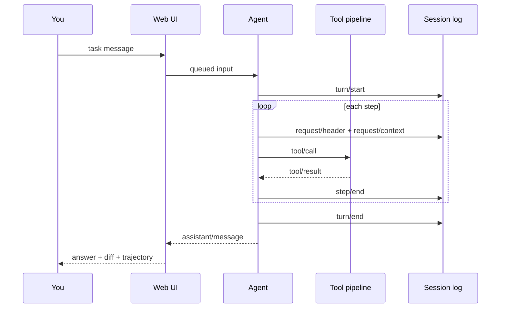

# End-to-End Walkthrough

One realistic session, start to finish: a repository with a failing test, a fix that has to be verified, and a result you can hand to a reviewer.

We will use `~/src/invoicer` as the project. Substitute your own.

## The shape of a run




Every arrow that matters is durable. If the process dies mid-run, the log still explains what happened.

## 1. Isolate the workspace

Do not debug your agent and your production credentials at the same time.

```bash
mkdir -p ~/dsh-labs && cd ~/dsh-labs
git clone git@github.com:you/invoicer.git
cd invoicer
git switch -c fix/rounding-total
```

Use a scratch `DSH_HOME` for this session so experiments do not pollute your daily profile:

```bash
export DSH_HOME=~/dsh-labs/home
npx @deepseek-ai/dsh@next web
```

## 2. Configure the model

In the UI: **Settings → Models** → paste a DeepSeek key, or add your own gateway.

Verify the route before you trust it with code:

```text
Reply with exactly: route ok
```

If that works, the adapter, credential, and protocol agree. If it does not, stop here and fix it — see [Troubleshooting](./9-troubleshooting.md).

## 3. Register the workspace

**Choose workspace →** `~/dsh-labs/invoicer`.

The composer enables once a workspace and a model exist. Registering the **repository root** (not `src/`) matters: it is the write boundary for the sandbox and the default search root for file tools.

## 4. Ask for a map, not a fix

```text
Orient yourself in this repository. Report:
1. what the project builds and the entry point
2. how tests are run (exact command)
3. the failing test and the code path it exercises
4. the three riskiest assumptions in that path
Do not modify files yet.
```

**What to look for:** the agent should name the test command from config (`package.json`, `Makefile`, `pyproject.toml`, CI workflow), not guess. If it guesses, correct it now — that correction is cheap; a wrong test command becomes a wrong fix later.

## 5. Make it plan

```text
Propose a minimal fix. List each file you will touch, the change, and how you
will verify it. Wait for my approval before editing.
```

Good plans read like a patch description. A plan that says "refactor the money module" for a rounding bug is a scope warning — narrow it:

```text
Too broad. Keep the change inside the rounding helper and its direct caller.
```

## 6. Execute, and watch the approvals

Approve the plan, then let it run:

```text
Proceed. Run only the affected test file after each edit.
```

Under the default `workspace-write` preset the agent may write inside the workspace but still asks before riskier operations. Read each prompt:

| Prompt type | What to check |
|---|---|
| Shell command | The command, the directory, and whether it deletes or moves anything |
| File write outside the workspace | Almost always a no |
| Network fetch | Whether the URL is needed to do the task |
| Plugin management | Requires full access; never approve casually |

If a prompt is confusing, reject it and ask the agent to explain first. Approval fatigue is how agents get elevated privileges by accident.

## 7. Inspect before you accept

Three independent checks, in increasing cost:

1. **The diff pane.** Review it like a PR: unrelated formatting, swallowed exceptions, tests weakened to pass.
2. **The Trajectory view.** Confirm the test actually ran, the command was the one you approved, and the result was a pass — not "tests look good" in prose.
3. **Your own shell.** The agent is not the authority on its own work.

```bash
git diff --stat && git diff
npm test -- --run src/money/rounding.test.ts
```

## 8. Ask for the parts you cannot see

```text
Summarize the root cause in two sentences, and list any assumption you made
about currency handling that the tests do not cover.
```

This surfaces the difference between "the test passes" and "the bug is fixed". A good run will tell you the second one is not proven.

## 9. Restart, resume, and fork

Quit the server, restart it, reopen the session: the conversation, model selection, approvals, and tool history are still there.

Two derived actions are worth knowing:

- **Fork** the session before a risky alternative approach. You keep the original run intact and compare outcomes.
- **Replay** the original when a reviewer asks why a particular file changed.

Session statistics (turns, steps, model time, tool time, time to first token) are the cheapest way to notice a runaway loop: a task that used 40 steps for a one-line fix usually means the tool set or the prompt is wrong, not the model.

## 10. Reuse the same work headlessly

Once the fix is understood, the repeatable part belongs in CI:

```bash
export DEEPSEEK_API_KEY=sk-...
npx @deepseek-ai/dsh@next headless \
  --permission-mode workspace-write \
  --json \
  "Run the test suite and summarize every failure with the file and assertion" \
  > run.jsonl
```

```bash
jq -r 'select(.type=="final") | .text' run.jsonl
```

The headless run keeps the same tools and sandbox defaults. What it drops is interactivity: no follow-up, no approval conversation. That is why the prompt must be complete, and why CI should use the narrowest permission preset that still works.

## 11. Hand off

If the repository has the opt-in GitHub review overlay configured, moving a PR from draft to ready can create a **read-only review session** automatically, scoped to that repository's workspace. It is a nice demonstration of the harness idea: a different task gets a different preset, sandbox, and prompt — same runtime.

See [Automation and SDKs](./7-automation-and-sdk.md) for the webhook setup.

## Walkthrough checklist

- [ ] Scratch `DSH_HOME` and a branch, not `main`
- [ ] Model route verified with a one-line prompt
- [ ] Workspace = repository root
- [ ] Orientation prompt before any edit
- [ ] Explicit, narrow plan approved
- [ ] Approval prompts read, not clicked
- [ ] Diff, trajectory, and local test all checked
- [ ] Root cause explained in prose
- [ ] Headless equivalent recorded for repeatability

:::tip Key takeaway
The winning pattern is boring: **orient → plan → approve → verify independently**. The harness makes each of those steps visible; it does not make them optional.
:::

---

**Next:** [Modes and plugins →](./6-modes-and-plugins.md) — change how the agent thinks, then extend what it can do.
