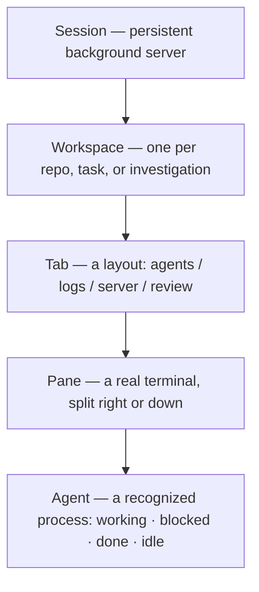
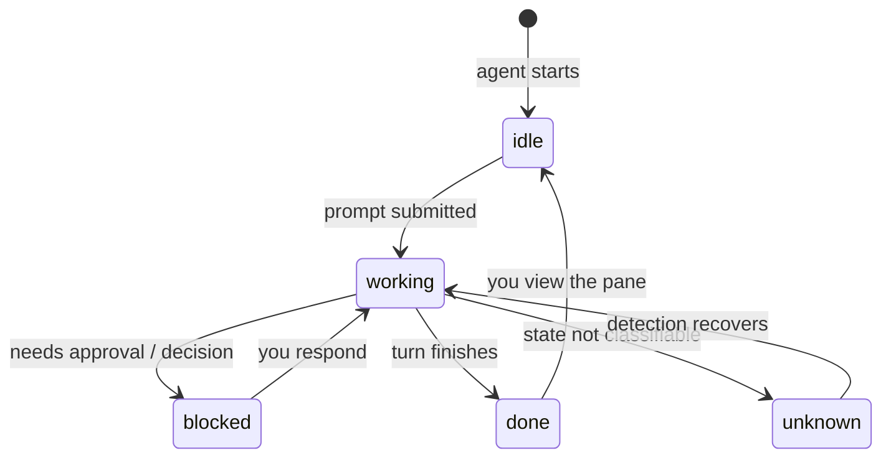

# Core Concepts

Six words and the whole model clicks: **session → workspace → tab → pane → agent**, plus **modes** for input.


## The mental model



Everything above the pane is organization. The pane is the only thing the process knows about — which is why an agent inside it behaves exactly as it would in any terminal.

## 1. Session

A session is a **persistent background server namespace**. Running `herdr` attaches to the default session; the server keeps panes alive while no client is attached.

Most people need only the default. Named sessions are fully separate runtimes — useful for isolating work:

```bash
herdr --session work          # use/create a named session
herdr session list
herdr session attach work
herdr session stop work       # stops its panes
herdr session delete work     # remove a stopped session
```

A named session has its own panes, tabs, workspaces, sockets, and runtime state. It still shares the global config file.

## 2. Workspace

A **workspace** is the project-level container — one per repo, task, or investigation. It owns tabs and panes, and its sidebar row rolls up the states of the agents inside it.

That rollup is the daily workflow: a blocked agent makes the workspace look blocked, so the workspace list doubles as a triage queue.

```bash
herdr workspace list
herdr workspace create --cwd ~/src/api --label api
herdr workspace rename <id> --label "api · auth refactor"
```

Worktree workspaces (one Git checkout each) are normal workspaces with provenance — see [Features tour](./6-features-tour.md).

## 3. Tab

A **tab** is a layout inside a workspace. Use it to separate concerns inside one project:

| Tab | What lives there |
|---|---|
| `agents` | Two or three coding agents, split by task |
| `logs` | Long-running dev server, test watcher, `tail -f` |
| `server` | SSH sessions, database shells, infra commands |
| `review` | `git diff`, PR checks, build output |

```bash
herdr tab create --workspace <id> --label review
herdr tab list --workspace <id>
```

## 4. Pane

A **pane** is a real terminal. It can be split **right** or **down**, renamed, resized, zoomed, read from the CLI, sent input, and closed. It survives client detach — that is the core promise.

```bash
herdr pane list --workspace <id>
herdr pane split --current --direction right --cwd "$PWD" --no-focus
herdr pane read <pane_id> --lines 80
herdr pane close <pane_id>
```

A pane exists whether or not an agent runs in it. Shells, servers, and test watchers belong here.

## 5. Agent

An **agent** is a process Herdr recognizes inside a pane. An agent is *not* a pane: it is the current occupant of one. Names follow the occupant and are cleared when the agent exits, is released, or is replaced.

| State | Meaning | What you should do |
|---|---|---|
| `working` | Actively running a turn | Leave it alone |
| `blocked` | Approval or question UI is waiting | Inspect, then decide |
| `done` | Finished; not viewed yet | Review the result |
| `idle` | Finished or waiting; already seen | Prompt it again if needed |
| `unknown` | Present but not confidently classified | Inspect; do not assume success |



Two subtleties worth knowing:

- **`done` and `idle` both mean ready for input.** `done` is "idle, but not seen yet." Viewing marks it seen; each client tracks that independently, so badges can differ between your TUI and another client.
- **`blocked` is deliberately strict.** It only fires when Herdr recognizes an actual approval/question UI. An unusual prompt may briefly read as `idle` — so never treat `idle` as permission to approve anything.

## 6. Modes

Herdr has three input modes:

| Mode | What it does |
|---|---|
| **Terminal** | Keys go to the focused pane, as usual |
| **Prefix** | `ctrl+b`, then one key, sends one command to Herdr |
| **Navigate** | A persistent surface for moving around the UI |

The mouse works in every mode. Press `prefix+?` to see the live keymap; every binding, including the prefix, is configurable under `[keys]`.

## IDs you will see

Herdr exposes stable, opaque IDs — useful for scripts:

| Object | Example |
|---|---|
| Workspace | `w1` |
| Tab | `w1:t1` |
| Pane | `w1:p1` |

Create commands return JSON with the new IDs; read them instead of predicting them:

```bash
herdr workspace create --cwd ~/src/api --label api --no-focus
# → .result.workspace.workspace_id, .result.tab.tab_id, .result.root_pane.pane_id
```

Closed tab and pane IDs are not reused. Moving a pane to another workspace gives it a new workspace-qualified ID (the response includes the new one).

## What survives what

| Event | Processes keep running | Layout returns | Agent conversation resumes |
|---|---|---|---|
| Client detach / reattach | ✅ | ✅ | ✅ (process never stopped) |
| Full server restart | ❌ | ✅ | Only with an integration's native session restore |
| Update without handoff | Usually | ✅ after restart | Via integration restore |
| Update with `--handoff` | Best effort | ✅ | ✅ if the handoff succeeds |

:::tip Key takeaway
Organize with **workspaces** (projects) and **tabs** (views). Split **panes** for terminals. Watch **agents** by state, and remember that `done` needs review while `blocked` needs a decision.
:::

---

**Next:** [End-to-end walkthrough →](./5-workflow-walkthrough.md) — put it all together with two agents, a dev server, and a review loop.
