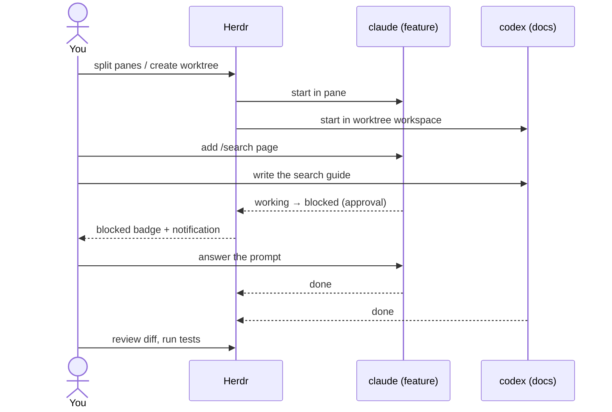

# End-to-End Walkthrough

Let's run a realistic job end to end: **ship a search page and its documentation on one repository, with two agents working in parallel, a dev server running, and you reviewing instead of babysitting.**

Everything below works from the TUI with the mouse; CLI equivalents are included so you can script it later.


## Step 0 — One-time setup

```bash
herdr integration install claude
herdr integration install codex
herdr integration install opencode
herdr integration status
```

Install the skill if you want an agent to be able to drive Herdr itself:

```bash
npx skills add herdrdev/herdr --skill herdr -g
```

## Step 1 — Create the workspace and panes

Start in the repo:

```bash
cd ~/src/portfolio
herdr
```

You get one pane. Split it so the agent and your own shell have separate terminals:

| Action | Mouse | Keyboard |
|---|---|---|
| Split right | Right-click → split right | `prefix+v` |
| Split down | Right-click → split down | `prefix+minus` |
| Move focus | Click the pane | `prefix+h/j/k/l` |

Scripted equivalent:

```bash
# create a labelled workspace; capture its root pane
ws=$(herdr workspace create --cwd ~/src/portfolio --label portfolio --no-focus)
root=$(printf '%s\n' "$ws" | jq -r '.result.root_pane.pane_id')

# give the agent its own pane on the right, keep focus in yours
split=$(herdr pane split "$root" --direction right --no-focus)
agent_pane=$(printf '%s\n' "$split" | jq -r '.result.pane.pane_id')

# start the agent in that pane
herdr agent start claude --kind claude --pane "$agent_pane"
```

Layout target for this walkthrough:

| Pane | Runs | Why |
|---|---|---|
| Top-left | Your shell / `git diff` | You stay in the reviewer seat |
| Top-right | Agent A (`claude`) — feature | The main implementation |
| Bottom | `npm run dev` | Live feedback while the agent edits |
| Second workspace | Agent B (`codex`) — docs | Isolated checkout, no file collisions |

## Step 2 — Give the agents work

Type into the agent pane like a teammate:

> *"Add a `/search` page that filters blog posts by title and tag. Reuse the existing card component, add a route, and verify the build passes."*

Or prompt from the CLI and wait for it to settle:

```bash
herdr agent prompt claude "Add a /search page that filters blog posts by title and tag; verify the build" \
  --wait --timeout 300000
```

`--wait` returns when the agent becomes `idle`, `done`, or `blocked`. If the turn runs longer, use a standalone wait with no timeout:

```bash
herdr agent wait claude --until done --until blocked
```

## Step 3 — Isolate the second agent with a worktree

Two agents in one checkout will fight over the same files. Give agent B its own Git worktree — Herdr creates the checkout **and** opens it as a grouped workspace:

```bash
herdr worktree create --cwd ~/src/portfolio --branch docs/search-guide --label "docs: search" --no-focus
herdr worktree list
```

Switch to that workspace (`prefix+w` or the sidebar), start Codex in its pane, and give it the documentation task:

> *"Write `docs/ai-tools/search.md` explaining the new search page, and link it from the AI Tools index. Do not touch source code."*

Worktrees are the clean answer to "parallel agents on one repo":

- Each agent sees only its own files.
- Builds and tests do not stomp each other.
- Merging is ordinary Git — branch by branch.
- `herdr worktree remove --workspace <id>` removes the checkout when you are done (add `--force` only for a dirty checkout you mean to discard).

## Step 4 — Supervise by state, not by staring

Now the sidebar does the work:



What each badge asks of you:

- **`working`** — nothing. Go do your own work.
- **`blocked`** — a decision. Click the pane, read the dialog, answer deliberately. (An unfamiliar dialog can read as `idle`; inspect before typing.)
- **`done`** — a review. Read the diff before you merge.
- **`unknown`** — inspect. It is not a success signal.

Notifications cover the walk-away case: finish and decision events surface even when Herdr is not focused.

## Step 5 — Review and verify (the part that matters)

Never merge on `done` alone. Verify like a reviewer:

```bash
# 1. see what the agent actually said at the end of the run
herdr agent read claude --source recent-unwrapped --lines 120

# 2. inspect the change yourself
git -C ~/src/portfolio diff --stat
git -C ~/src/portfolio diff

# 3. run the checks the agent claims passed
herdr pane run <shell_pane_id> "npm run build && npm test"
herdr pane wait-output <shell_pane_id> --regex "success|error|failed" --timeout 300000
```

If the agent stopped to ask something, inspect before answering:

```bash
herdr agent wait claude --until blocked --timeout 120000
herdr agent read claude --source recent-unwrapped --lines 80
herdr agent send-keys claude esc     # or enter, up, ctrl+c — deliberately
```

## Step 6 — Wrap up

```bash
# merge the docs branch when reviewed
git -C ~/src/portfolio worktree list
herdr worktree remove --workspace <docs_workspace_id>

# leave the session running, or stop everything
herdr server stop
```

Keeping the session alive is usually the right call: tomorrow's `herdr` reattaches to the same layout, and integrations restore agent conversations after a server restart.

## The rules that prevent pain

1. **One driver per checkout.** Two agents, two worktrees — always.
2. **Keep one human-owned pane.** Do not let every pane be an agent; you need a place to run `git diff` and tests.
3. **Treat `done` as "review ready," not "merged."**
4. **Answer `blocked` slowly.** Approval dialogs are exactly where automation should not guess.
5. **Close worktrees, not branches.** `worktree remove` deletes the checkout; your branch and commits stay.

:::tip Key takeaway
Workspace per project, pane per agent, worktree per parallel writer, sidebar for triage, human diff for the merge. That is the entire operating model.
:::

---

**Next:** [Features tour →](./6-features-tour.md) — the rest of the toolbox: remote machines, plugins, notifications, and the automation API.
